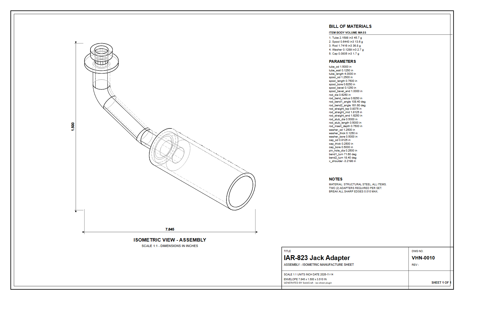

# iso-sheet — isometric manufacturing sheet for SolidCraft

A [SolidCraft](https://github.com/tangency-labs/solidcraft) plugin that turns the open design into a
one-page isometric shop sheet you can hand to a machinist.

It reads the model through the app's own command surface, projects every body to a true isometric
with hidden lines removed, and returns an ANSI B (17 × 11 in) SVG sheet with a title block, bill of
materials, parameter table, notes and overall dimensions.



## What it does

1. `document.inspect` — design name, units, bodies, parameters
2. `inspect.measure` — volume, mass and bounding box of every body
3. `model.mesh` — triangles per body, at a chord tolerance
4. Projects to a true isometric (yaw −45°, pitch 35.264°), builds a 1500 px depth buffer, extracts
   crease / boundary / silhouette edges and clips each one into visible and hidden runs
5. Composes the sheet at an automatic drafting scale (never larger than 1:1):
   - isometric view, hidden lines dashed
   - overall width/height dimensions with extension lines
   - bill of materials: volume and mass per body
   - parameter table in the design's unit, angles converted from rad to degrees
   - notes and title block (title, drawing number, scale, units, date, envelope)

## Install

**From the .zip** (desktop app): `Preferences › Plugins › Install plugin…` and pick
`iso-sheet.zip` from the [latest release](../../releases).

**As a folder**: unpack `plugin.json` and `iso-sheet.wasm` into
`<plugins folder>/iso-sheet/` — on Windows that is
`%LOCALAPPDATA%\SolidCraft\plugins\iso-sheet\`.

The app reads the plugins folder once per session and after its own installer runs, so after a manual
copy **restart SolidCraft**; an install through the UI appears immediately.

## Use

Run it from **Model tab › Plugins group › “Iso Sheet”**, or from the **Plugins menu** in the app bar
(*Isometric Sheet*). One click runs it on the open design with the defaults.

Entry inputs (all optional, shown as a form in the app):

| Input | Default | Meaning |
|---|---|---|
| `body_names` | every body | comma-separated body names to draw (`bodies` still accepted from agent/CLI calls) |
| `hidden` | `true` | draw occluded edges dashed |
| `tolerance` | `0.15` | mesh chord tolerance in mm |
| `scale` | auto | scale denominator, e.g. `2` for 1:2 |
| `title`, `dwg_no`, `date` | design name / empty | title block text |
| `notes` | none | notes printed under NOTES, separated by `;` |
| `output` | none | file name for the SVG inside the folder granted to the plugin |
| `inline` | `false` | always return the SVG in the result |

The app's plugin dialog draws scalar fields only: one array-typed input makes it fall back to
"This entry needs to be run from the agent or CLI." The manifest also requires properties named
`selection`, `target`, `targets`, `bodies` or `body_ids` to be arrays. So the body filter is
declared as `body_names` (a string), and `notes` is a `;`-separated string. Agent and CLI callers
may still pass `bodies` or `notes` as real arrays.

If you pass `output` the SVG is written to the plugin's granted folder. Without a granted folder the
sheet is returned in the result instead (the reply also carries a `hint`). SVG output is vector, so it
prints or converts to PDF at any size.

## Permissions

The manifest asks for exactly what it uses:

- capability `commands@0.1`
- commands `document.inspect`, `inspect.measure`, `model.mesh` — nothing that edits the design
- one file grant, `output` (read + write), only touched when `output` is given
- no `net`, no clock, no command groups

## Build

```sh
rustup target add wasm32-unknown-unknown
cargo install cargo-component
cargo component build --release --target wasm32-unknown-unknown
```

Copy `target/wasm32-unknown-unknown/release/iso_sheet.wasm` next to `plugin.json` as `iso-sheet.wasm`.

**Why `wasm32-unknown-unknown` and not `wasm32-wasip1`?** A `wasip1`/`wasip2` component imports WASI,
and a host whose WASI version differs refuses it at link time (`wasi:cli/environment` signature
mismatch). The `unknown-unknown` build has no WASI imports at all, only the plugin's own interfaces,
so it links against any host that implements `craft:plugin@0.1.0`.

The WIT contract is `craft:plugin@0.1.0` (`wit/plugin.wit`): world `command-plugin`, exporting
`craft:plugin/entry@0.1.0` `execute(entry, params)` and importing `commands`, `log`, `control`,
`files` and `clock`.

## Limits

The manifest asks for 20 G fuel, 96 MiB and a 30 s deadline. A full five-body assembly at 0.15 mm
takes roughly 1 s: about 5 700 triangles meshed, 924 visible and 1 357 hidden line segments.

## License

Dual-licensed under either of

- Apache License, Version 2.0 ([LICENSE-APACHE](LICENSE-APACHE))
- MIT license ([LICENSE-MIT](LICENSE-MIT))

at your option.

Unless you explicitly state otherwise, any contribution intentionally submitted for inclusion in
this project by you, as defined in the Apache-2.0 license, shall be dual licensed as above, without
any additional terms or conditions.
